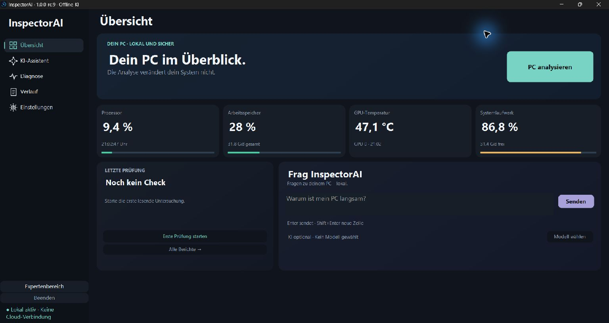
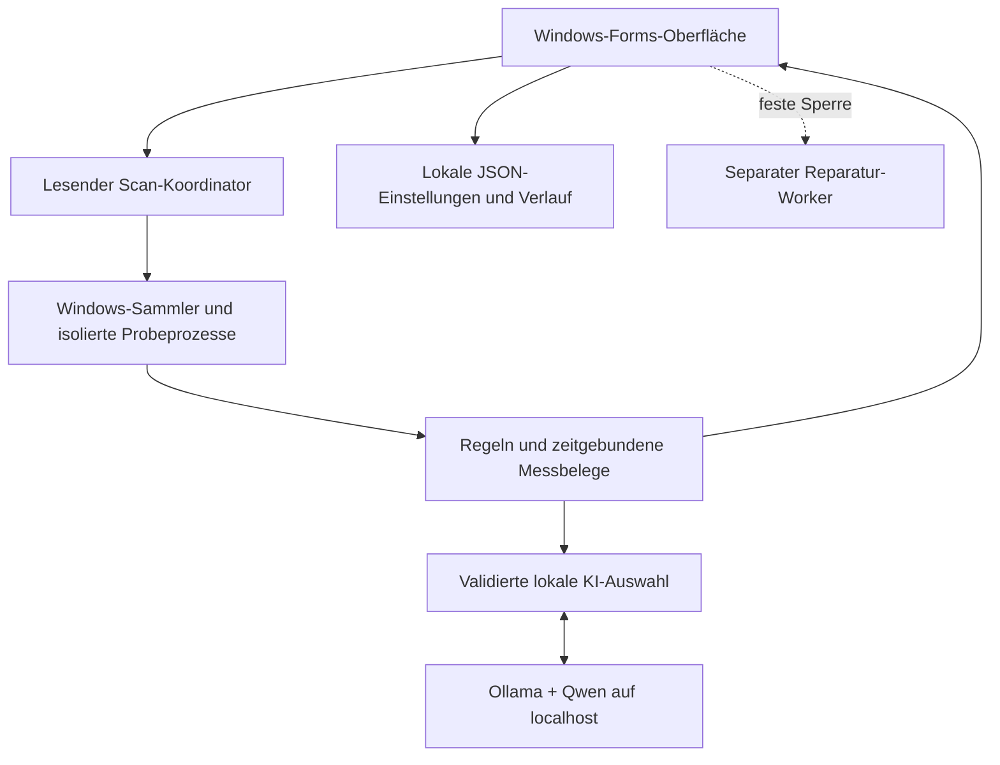

# InspectorAI

**Lokale Windows-Diagnose mit nachvollziehbaren Messdaten und integriertem KI-Assistenten.**

InspectorAI verbindet ein natives Windows-Dashboard, einen lesenden Gesundheitscheck und lokale KI-Auswertung. Das Projekt zeigt die Integration von Windows-Schnittstellen, asynchronen Desktop-Abläufen und einer bewusst begrenzten KI-Diagnose.

> **Projektstatus:** Private Testausgabe, Anwendungsversion `1.0.0-rc.9`, Qualitätsstand vom 23. November 2026. Keine uneingeschränkte Verkaufsfreigabe. Systemändernde Reparaturen und Paketinstallationen sind in dieser Ausgabe deaktiviert.



## Funktionen

- **Dashboard:** aktuelle CPU-/RAM-Werte, Systemlaufwerksbelegung und verfügbare NVIDIA-GPU-Temperatur; Messlücken werden kenntlich gemacht.
- **Gesundheitscheck:** sechs unabhängig bewertete Quellen – Windows-Ereignisse, Hardware/Treiber, Netzwerk, Datenträger, CPU/RAM und Laufzeitkomponenten.
- **Befundhilfe:** Beobachtung, Einordnung, Unsicherheit und konkrete nächste Untersuchung statt unbegründeter Fehlerbehauptungen.
- **Lokaler KI-Chat:** Fragen zu PC-Messdaten, allgemeiner Chat, Folgefragen, Enter/Senden und Abbruch. Die Offline-Ausgabe enthält Ollama und `qwen2.5:1.5b`.
- **Expertenwerkzeuge:** Ressourcen, Ereignisse, strukturierte KI-Diagnose, Komponentenstatus, DNS-Vorprüfung, Softwareinventar, erweiterter Check und Reparaturverlauf.
- **Berichte und Verlauf:** auf Wunsch lokale Momentaufnahmen und eingeschränkter anonymisierter JSON-Export.
- **Windows-Verteilung:** selbstständige Windows-x64-Ausgabe, Inno-Setup-Installer und Portable-Paket mit enthaltener Offline-KI.

Die Anwendung ist kein autonomer Systemadministrator. Ein Messwert, Windows-Ereignis oder KI-Text beweist keine konkrete Fehlerursache. Die KI führt keine frei erzeugten Shell-Befehle aus.

## Technologien

| Bereich | Nachgewiesene Grundlage |
|---|---|
| Desktop | C#, .NET 10, Windows Forms, GDI+/System.Drawing |
| Windows-Daten | Win32/PInvoke, WMI über System.Management, Ereignisprotokolle, Registry, .NET-System-APIs |
| Lokale KI | Ollama, Qwen2.5:1.5b, localhost-HTTP, System.Text.Json und strukturierte Antwortvalidierung |
| Verteilung | self-contained `win-x64`, Inno Setup, SHA-256 |
| Entwicklung/Tests | .NET-Konsolen-Testprogramme, PowerShell, Python-Prüfwerkzeuge, CMD-Starter |

Die aktuelle Oberfläche ist **keine HTML-/CSS-/React-Anwendung**. Eine WebView2-Abhängigkeit und frühere Web-/Cloud-Integrationspfade sind noch im Code vorhanden; die unauthentifizierte Webansicht und Cloud-KI sind in dieser Ausgabe gesperrt. Python wird zum Betrieb der fertigen Anwendung nicht benötigt.

Details und genaue Versionen: [Technologieinventar](docs/TECHNOLOGIEN.md).

## Architektur



Es handelt sich um eine modulare Desktop-Anwendung mit separater Diagnostikbibliothek und separatem Worker – nicht um eine Microservice-Plattform. UI-Ereignisse, Sammler und Regeln sind teilweise weiterhin im Desktop-Projekt organisiert.

[Architektur im Detail](docs/ARCHITEKTUR.md) · [Funktionen und technische Leistungen](docs/FUNKTIONEN.md)

## Build und Tests

Für den **Quellcode-Neubau**: Windows, .NET SDK 10 und verfügbare NuGet-Pakete. Die fertige private Ausgabe benötigt keine separat installierte .NET-, Python- oder Ollama-Laufzeit.

```powershell
dotnet build src/Inspector.Desktop.Windows/Inspector.Desktop.Windows.csproj -c Release
dotnet run --project tests/DiagnosticRules.SelfTests -c Release
dotnet run --project tests/InspectorAI.ProductAcceptance -c Release -- --final-navigation
dotnet publish src/Inspector.Desktop.Windows/Inspector.Desktop.Windows.csproj -c Release -r win-x64 --self-contained true -o artifacts/portable
```

Ein reines `dotnet publish` erzeugt noch kein vollständiges Offline-KI-Paket: Die separat gebündelten KI-Laufzeiten, Modellgewichte, der veröffentlichte Worker und alle erforderlichen Lizenzhinweise müssen zusätzlich bereitgestellt werden. Inno Setup verarbeitet anschließend `installer/InspectorAI.iss` mit dem definierten `PayloadFolder`. Es gibt in diesem Entwurf noch keinen öffentlichen Downloadlink.

## Qualität und Grenzen

Dokumentiert sind reale Windows-Prüfungen, lokale Modellantworten, Abbruch-/Fehlerszenarien und gezielte DPI-Regressionen. Die abschließende native Benutzerablaufprüfung umfasst 22 bestandene Prüfungen; sie ersetzt keine vollständige manuelle Abnahme jedes Dialogs. Installation, Upgrade und Deinstallation wurden mit getrennter Testkennung geprüft. Die finale Setup-EXE wurde als echter Assistent geöffnet; Portable wurde aus dem finalen ZIP gestartet.

Offen bleiben insbesondere ein sauberes unabhängiges Windows-System, ein echter Betriebssystem-Neustart, physisches Misch-DPI und positive isolierte Systemreparaturtests. Freie KI-Antworten sind nicht universell fachlich verifiziert. Der vorhandene GitHub-Workflow ist historisch und nicht als aktueller erfolgreicher CI-Lauf belegt.

[Nachweisumfang und Testgrenzen](docs/TESTSTATUS.md)

[Veröffentlichungsprüfung](docs/PUBLIKATIONSPRUEFUNG.md) · [Repository-Struktur](docs/REPOSITORY-STRUKTUR.md) · [Screenshot-Konzept](docs/SCREENSHOTS.md)

## Datenschutz und Sicherheit

- Lokale KI-Kommunikation über Loopback; Cloud-KI ist deaktiviert.
- Strukturierte Auswertung nutzt begrenzte Messbelege und vorhandene Befund-IDs.
- Prüfquellen haben Fristen und ausgewiesene Teil-/Fehlerzustände.
- Hardware-/Ereignisabfragen laufen isoliert; ungültige oder verspätete Ergebnisse werden begrenzt bzw. verworfen.
- Reparaturkatalog, Worker-Grenzen und feste Ausführungssperre bleiben erhalten.
- Diagnoseberichte, Kontodaten, Schlüssel, unredigierte Screenshots und Testprofile gehören nicht ins öffentliche Repository.

„Lokal“ bedeutet nicht, dass jede optionale Funktion ohne Netzwerk arbeitet: gesondert gekennzeichnete DNS-/Paketabfragen können Netzwerkzugriff benötigen.

## Über das Projekt

InspectorAI ist mein eigenständiges IT-Portfolio-Projekt, das ich mit Unterstützung KI-gestützter Entwicklungswerkzeuge umgesetzt habe.

Ziel war die Entwicklung einer modernen Windows-Anwendung, die Systemdaten analysiert, mögliche Probleme erkennt und mithilfe eines lokal integrierten KI-Assistenten verständliche Erklärungen und Lösungsvorschläge liefert.

Das Projekt verbindet Softwareentwicklung, Windows-Systemdiagnose, künstliche Intelligenz und Qualitätssicherung. Die Anwendung wurde unter Windows praktisch getestet und als installierbare Offline-Testversion bereitgestellt.
